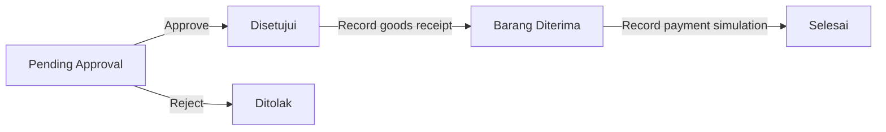
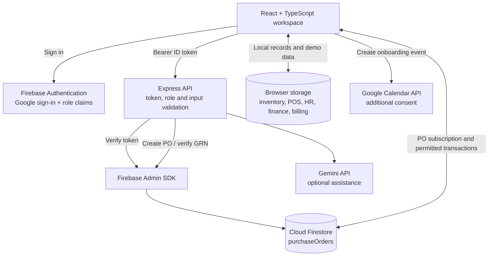

<div align="center">

<picture>
  <source media="(prefers-color-scheme: dark)" srcset="docs/images/inventora-mark-inverse.svg">
  
</picture>

# Inventora

**Track stock, manage purchase orders, and record sales in one workspace.**

[](https://react.dev/)
[](https://www.typescriptlang.org/)
[](https://vite.dev/)
[](https://tailwindcss.com/)
[](https://firebase.google.com/)
[](https://expressjs.com/)

[Tour](#a-quick-tour) · [How it works](#how-it-works) · [Data](#data-and-storage) · [Getting started](#getting-started) · [API](#api) · [Status](#project-status)

</div>

<br>

Inventora is a web application for inventory, purchasing, and point-of-sale operations, developed as a TUBES software engineering project. Warehouse staff can review stock and create purchase orders, finance staff can approve orders and record payment simulations, and cashiers can complete cash sales against the available inventory.

The same workspace includes employee records, payroll simulations, local invoices, subscription simulations, and optional Gemini assistance. Access follows the signed-in account's role.

> **Storage model:** Firebase Authentication handles sign-in, and Cloud Firestore stores live purchase orders. Inventory, POS sales, HR, finance invoices, and billing records currently use browser storage. Their storage boundaries are described below.

## At a glance

| | |
|---|---|
| **Main workflow** | Inventory → purchase order → approval → goods receipt → payment record |
| **Sales** | Cash checkout, item discounts, change calculation, sales history, and printable/PDF receipts |
| **Accounts** | Google sign-in, five account roles, and four local demo roles |
| **Database** | Firebase Cloud Firestore, a NoSQL document database; active application collection: `purchaseOrders` |
| **Local records** | Inventory, POS, employees, payroll, finance invoices, and billing simulations |
| **Interface** | English and Indonesian, light/dark themes, responsive navigation, original Inventora logo |
| **Amounts** | Indonesian rupiah; POS and new payroll entries validate whole-rupiah amounts |
| **Assistant** | Optional Gemini requests through the authenticated Express API |

## A quick tour

### 1. Sign in and open your workspace

The opening page leads to Google sign-in. New Google accounts receive the `User` role, with access to Overview and Settings. Staff access comes from a verified Firebase custom claim.

For a local walkthrough, open **Explore the demo** on the login page and choose Super Admin, Warehouse Manager, Finance Manager, or HR Manager. These choices create a browser demo session; they do not grant Firebase staff privileges.

The dashboard sidebar groups operational modules and workspace tools. It collapses into an icon rail on desktop and opens as a drawer on smaller screens. Module visibility, active-page indicators, and pending PO counts follow the account and current records.

### 2. Check inventory and record a sale

**Inventory** shows SKU quantities, minimum stock, and items that need attention. A restock action carries the selected item and quantity into the purchase-order form.

**Point of Sale** uses the same local inventory snapshot. Select products, enter quantities and prices, apply item discounts, and record the cash received. Checkout validates current stock and payment before saving the sale, updated inventory, and stock movements together.

Sales history opens the saved receipt for printing or PDF download. The optional 11% VAT setting is a simulation value.

### 3. Follow a purchase order

Create a PO with vendor details, dated delivery information, line items, and calculated totals. The stored workflow is:



The goods receipt note (GRN) records received quantities and item condition. Discrepancies must be resolved before payment, and live receipt verification is written by the server.

PO documents retain line items, receipt information, and payment information together. Receiving a PO currently updates its procurement record; it does not automatically replenish the browser-local inventory.

### 4. Use the supporting modules

| Module | What it provides |
|---|---|
| **Overview** | Role-specific summaries, stock attention, and purchase-order activity from available records |
| **Finance** | Browser-local invoices, payment-status simulations, PDF records, and downloadable reminder email drafts |
| **HR** | Employee records, period-based payroll simulations, payslip PDFs, and optional Google Calendar onboarding events |
| **Analytics** | Charts with labelled sample data and an optional Gemini analyst |
| **Billing** | Local plan, add-on, renewal, and invoice simulations |
| **Settings** | Account preferences, language, browser-data backup, and workspace controls where permitted |

Finance reminders download an `.eml` draft for the user to send. Payroll, vendor payments, and subscription actions record simulations; they do not transfer funds or charge a bank account.

## How it works



1. **Frontend.** React renders the application with Tailwind CSS, Lucide icons, Recharts, Motion, and dotLottie. Navigation and forms use the current account's permissions.
2. **Server.** Express serves the API and runs Vite middleware during development. Protected endpoints verify Firebase ID tokens and staff roles before handling requests.
3. **Procurement.** PO creation and receipt verification use the Admin SDK. Approval and payment-state updates use Firestore transactions constrained by `firestore.rules`.
4. **Local operations.** Inventory and POS share a browser snapshot. Other local modules keep their own records, validation, and recovery states.
5. **Optional services.** Gemini calls run on the server. Google Calendar authorization is requested separately from basic sign-in.

### Account access

| Role | Modules | Procurement actions |
|---|---|---|
| **Super Admin** | All modules | Create, approve/reject, receive, record payment |
| **Warehouse Manager** | Overview, Inventory, Point of Sale, Procurement | Create and receive |
| **Finance Manager** | Overview, Point of Sale, Procurement, Finance, Analytics, Billing | Approve/reject and record payment |
| **HR Manager** | Overview and HR | — |
| **User** | Overview and Settings | — |

The role name is stored in the Firebase custom claim `role`. A valid sign-in without that claim receives basic User access. Unknown claim values do not grant staff access.

See [authorization.ts](src/lib/authorization.ts), [server authentication](server/auth.ts), and [Firestore rules](firestore.rules) for the enforced permissions.

## Data and storage

| Data | Current storage | Scope |
|---|---|---|
| Account identity | Firebase Authentication | Google account and verified role claims |
| Live purchase orders | Firestore `purchaseOrders` | PO lines, GRN, receipt verification, and payment records within each document |
| Demo purchase orders | Browser storage | Local demo records |
| Inventory, POS sales, stock movements | Shared `localStorage` commerce snapshot | Separate demo and operational keys; no Firestore sales synchronization |
| Employees and payroll history | `localStorage` | Local records and payroll simulations |
| Finance invoices and settlement status | `localStorage` | Local invoice simulations |
| Subscription plans, add-ons, billing invoices | `localStorage` | Local subscription simulations |
| Pending PO approval/rejection | Browser queue | Account-owned mutations retried when connectivity returns |
| Workspace backup | Downloaded JSON | Inventora browser-local data only |

Browser-local data does not follow the user to another device or browser. The JSON backup is not an export of Firebase Authentication or Firestore.

The offline queue handles PO approval and rejection. It does not provide offline synchronization for every form or POS sale. Damaged records and failed writes are reported through recovery/error states rather than silently replaced with new sample records.

The Firebase coursework package is documented in [database/firestore/README.md](database/firestore/README.md). The separate [SQL coursework package](database/tubes/README.md) is documentation material; it is not the application's active database.

## Getting started

**Requirements:** Node.js 24 LTS and npm. Firebase-backed features need a Firebase project; Gemini assistance additionally needs an API key.

### 1. Install and run the local demo

From the repository root, on a fresh checkout:

```powershell
npm ci
Copy-Item .env.example .env
npm run dev
```

Open [http://localhost:3000](http://localhost:3000), select **Open workspace**, then expand **Explore the demo** on the login page. Keep your existing `.env` if you have already configured the project.

The local demo can be used without a Gemini key or Firebase Admin credentials. Cloud operations and authenticated AI calls require the configuration below.

On macOS or Linux, use `cp .env.example .env` in place of `Copy-Item`.

### 2. Configure Firebase sign-in and live procurement

1. Register a Firebase web app and put its web configuration in `firebase-applet-config.json`.
2. Enable **Google** in Firebase Authentication. Add `localhost` and your deployment hostname to **Authorized domains**.
3. Create the Cloud Firestore database and review/deploy this repository's `firestore.rules` to the matching project.
4. Give the server Firebase Admin access through Application Default Credentials or an external service-account JSON file.
5. Assign staff accounts a valid `role` custom claim using trusted Firebase Admin tooling. Sign in again after a role change.

The web configuration contains client identifiers. Service-account private keys and the Gemini key belong on the server.

Example server settings in `.env`:

```dotenv
FIREBASE_PROJECT_ID=your-firebase-project-id
GOOGLE_APPLICATION_CREDENTIALS=C:/secure/inventora-admin.json
GEMINI_API_KEY=your-gemini-api-key
```

The credential path is an example. Keep the JSON outside the repository. On a deployed server, an attached service identity can provide Application Default Credentials instead of a local key file.

| Variable | Purpose |
|---|---|
| `FIREBASE_PROJECT_ID` | Optional server project override; defaults to the web configuration's project ID |
| `GOOGLE_APPLICATION_CREDENTIALS` | Local Admin credential path when using a service-account file |
| `GEMINI_API_KEY` | Enables server-side Gemini requests |
| `GEMINI_MODEL` | Primary model; see `.env.example` for the configured default |
| `GEMINI_FALLBACK_MODEL` | Fallback model; set to `none` to disable fallback |

Use models available to your Google project. Restart the server after changing environment variables. Basic Google login does not request Sheets or Calendar permissions; the Calendar action requests additional consent when used.

### 3. Build and run the production server

```powershell
npm run build
npm start
```

The frontend is written to `dist/` and the backend to `build/server.cjs`. `npm start` serves both the application and its API at [http://localhost:3000](http://localhost:3000).

`npm run preview` previews the frontend build only. Use the Express server when testing API-dependent features.

The repository's `firebase.json` configures Firestore rules and the local emulator. It does not include a Firebase Hosting target, Functions deployment, or App Hosting configuration. Hosting the frontend alone will not run the Express API. The current server listens on port 3000; deployment platforms that require an environment-provided port need that startup configuration adapted.

## API

Except for health, these endpoints require a Firebase ID token in `Authorization: Bearer <ID_TOKEN>` and the role shown below.

| Endpoint | Purpose | Allowed roles |
|---|---|---|
| `GET /api/health` | Process status, uptime, and memory information | Public |
| `POST /api/purchase-orders` | Validate and create a purchase order | Super Admin, Warehouse Manager |
| `POST /api/purchase-orders/:poId/receipt` | Validate and record a GRN | Super Admin, Warehouse Manager |
| `POST /api/analyst` | Analyse supplied dashboard context | Super Admin, Finance Manager |
| `POST /api/copilot` | Respond to a message with supplied workspace context | All staff roles |
| `POST /api/ai/po-risk` | Analyse a supplied PO for potential risks | Super Admin, Warehouse Manager, Finance Manager |
| `POST /api/ai/forecast-restock` | Request restock suggestions from supplied inventory | Super Admin, Warehouse Manager |
| `POST /api/ai/parse-invoice` | Extract and validate PO fields from invoice text | Super Admin, Warehouse Manager |

AI endpoints share an in-memory limit of 30 requests per minute per verified user, with IP as a fallback identifier. Requests also depend on the configured Gemini model, quota, and provider availability.

<details>
<summary><b>Example: parse invoice text</b></summary>

```http
POST /api/ai/parse-invoice
Authorization: Bearer <FIREBASE_ID_TOKEN>
Content-Type: application/json

{
  "text": "Vendor: PT Contoh Nusantara\nInvoice: INV-001\n2 Keyboard @ Rp250000 = Rp500000\nTotal: Rp500000"
}
```

The endpoint validates extracted line quantities, prices, and totals before returning usable data. The example uses fictional invoice details.

</details>

`/api/health` reports that the server process is responding. It does not prove that Firebase credentials, Google OAuth, or Gemini requests are working.

## Verification

```powershell
# Unit, React DOM, and local HTTP regression checks
npm test

# TypeScript checking
npm run lint

# Frontend and server production builds
npm run build
```

The most recent recorded local application run on **18 November 2026** passed **175 tests**, TypeScript checking, and the production build. The suite covers permissions, form validation, POS checkout, storage failures, stale requests, PO workflows, sign-in handlers, and sidebar keyboard interactions.

Firestore rules checks run separately against a local emulator. With Java 21 or later available:

```powershell
npx --yes firebase-tools emulators:exec --only firestore --project demo-inventora "npm run test:rules"
```

That command uses the local `demo-inventora` project. See [tests/firestore.rules.test.ts](tests/firestore.rules.test.ts) for the emulator scenarios.

The recorded application checks use DOM tests, mocks, and local HTTP. They do not establish live Firebase/Gemini availability or visual correctness in a real browser. The build currently reports some chunks above 500 kB.

## Repository layout

<details>
<summary><b>Show folders</b></summary>

| Path | Contents |
|---|---|
| `src/App.tsx` | Routes, session handling, dashboard navigation, and settings |
| `src/components/` | Business modules, shared controls, login, opening animation, and sidebar |
| `src/lib/` | Validation, storage, inventory/POS transactions, procurement rules, exports, and hooks |
| `src/firebase.ts` | Firebase client setup, Google sign-in, and optional integration authorization |
| `server.ts` | Express application, API routes, and development/production startup |
| `server/` | Firebase Admin operations, token/role middleware, AI requests, and static asset serving |
| `public/` | Service worker, app manifest, and public assets |
| `tests/` | Application regression tests and the separate Firestore rules suite |
| `database/firestore/` | Firebase coursework data, examples, and emulator checks |
| `database/tubes/` | Separate SQL coursework material |
| `docs/` | Audit notes, UI decisions, UML sources, and class-diagram documentation |
| `scripts/` | Local utility scripts |
| `firestore.rules` | Firestore access and workflow constraints |
| `firebase.json` | Firestore rules and emulator configuration |
| `.env.example` | Documented server environment variables |
| `dist/`, `build/` | Generated frontend and backend output; excluded from version control |

</details>

## Project status

| Area | Current state |
|---|---|
| **Application UI** | Implemented with responsive navigation, English/Indonesian labels, and light/dark themes |
| **Google login and roles** | Implemented; live use requires the project's Firebase configuration |
| **Cloud procurement** | Implemented for PO creation, approval/rejection, receipt verification, and payment-state records |
| **Inventory and POS** | Implemented with browser-local persistence and cash checkout |
| **Finance, HR, and billing** | Local records and simulations; no bank/payment processing |
| **AI assistance** | Implemented server endpoints; requires staff authentication and a working Gemini configuration |
| **Calendar onboarding** | Implemented, subject to Google API enablement and additional user consent |
| **Cross-device POS synchronization** | Not implemented |
| **Google Sheets export** | OAuth scope exists; an export workflow is not implemented |
| **Deployment configuration** | Firestore rules/emulator included; application hosting must be configured separately |

See the [latest bug-fix audit](docs/perbaikan-audit-2026-11-18.md) for the earlier audit results, remaining dependency advisories, and detailed storage/recovery changes. That report predates the later login and sidebar tests.

## Notes for contributors

- Keep business validation in the shared helpers and server boundaries. Hiding a menu is not sufficient authorization for an API or Firestore write.
- Keep the original four-square logo, existing typography, and real module names when changing the interface.
- Preserve damaged local records for recovery. A failed save must not show a successful transaction.
- Keep demo procurement and commerce data separate from operational data.
- Use the shared CSV/PDF export helpers and preserve saved transaction amounts when regenerating documents.
- Keep `.env` files, private keys, and service-account JSON outside source control. Browser backup exports can contain operational records and should be handled accordingly.
- Run the relevant regression tests and TypeScript checking after code changes; use the emulator suite when changing Firestore rules.

## Acknowledgements

- [Firebase](https://firebase.google.com/) for Authentication, Cloud Firestore, and the Admin SDK.
- [Google Gemini](https://ai.google.dev/) for the optional analysis and extraction service.
- [React](https://react.dev/), [TypeScript](https://www.typescriptlang.org/), [Vite](https://vite.dev/), and [Express](https://expressjs.com/) for the application stack.
- [Tailwind CSS](https://tailwindcss.com/), [Lucide](https://lucide.dev/), [Recharts](https://recharts.org/), [Motion](https://motion.dev/), and [dotLottie](https://developers.lottiefiles.com/docs/dotlottie-player/) for interface styling, icons, charts, and animation.
- [Plus Jakarta Sans](https://fonts.google.com/specimen/Plus+Jakarta+Sans) for the interface typeface.

<p align="center"><sub>Inventora · Inventory, purchasing, and point of sale</sub></p>

